# Slack SDR Agent

**An AI sales assistant that lives in Slack.** An SDR pastes a LinkedIn URL, and about 20 seconds later the thread
holds a fully researched lead: role, company, verified email, AI talking points, and a record already in the CRM.
After the call, one button press either starts a LinkedIn + email follow-up sequence and finds other buyers at the
same company, or turns the SDR's call notes into a personalised LinkedIn message.

Built with **n8n** (self-hosted), **Supabase**, **Deepline**, **Prospeo**, an **LLM**, **HubSpot**, **HeyReach** and
**Instantly**, all wired together behind a single Slack command.

<!-- LOOM: paste the video link here, e.g. [▶ Watch the 4-minute demo](https://www.loom.com/share/...) -->

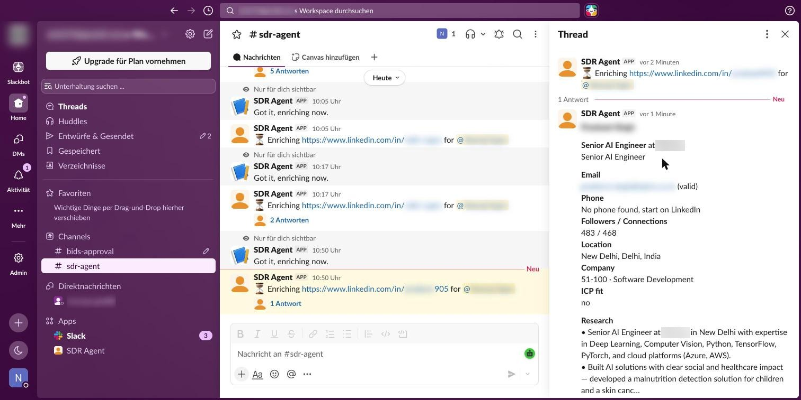

| | |
|---|---|
| ⏱️ **Time to a researched lead** | ~20 s (was 10–15 min of manual tab-hopping) |
| 🧩 **Workflows** | 5 main + 10 sub-workflows, generated from code |
| ✅ **Tests** | 33 end-to-end checks across every branch, all passing |
| 🔁 **Safe by design** | Double-clicks, Slack retries and re-runs never double-enrol or double-send |
| 💸 **Enrichment cost** | A few cents per lead; paid lookups run only when the cheaper ones miss |

---

## Contents

1. [The problem](#1-the-problem)
2. [What the SDR sees](#2-what-the-sdr-sees)
3. [Live run, end to end](#3-live-run-end-to-end)
4. [Architecture](#4-architecture)
5. [How each part works](#5-how-each-part-works)
6. [Data model](#6-data-model)
7. [Reliability, safety and security](#7-reliability-safety-and-security)
8. [Engineering decisions and trade-offs](#8-engineering-decisions-and-trade-offs)
9. [Testing](#9-testing)
10. [Cost](#10-cost)
11. [Run it yourself](#11-run-it-yourself)
12. [Repository layout](#12-repository-layout)
13. [What I'd build next](#13-what-id-build-next)

---

## 1. The problem

An SDR's day is a loop: find a prospect on LinkedIn, look them up in four tools, call, then log the result and set up
follow-ups. The research and admin around each call take longer than the call itself, and they're where the follow-up
falls through the cracks.

**The brief.** Build an agent that does that work from inside Slack, where the team already is:

- **Intake:** `/prospect <LinkedIn URL>` creates the lead, without duplicates.
- **Enrichment:** profile, company, verified email, phone and short AI research.
- **CRM:** upsert the company and contact into HubSpot without overwriting an existing owner.
- **Call outcomes:**
  - *No answer* → LinkedIn + email sequences, and find more people at the account.
  - *Picked up* → an AI-drafted follow-up the SDR approves.
  - *Wrong person* → find the right person.
- **Ops:** errors surface in Slack with a Retry button, stuck work is swept, and a daily summary is posted.

The original brief used **Clay** tables for enrichment and account search. I replaced both tables with direct API calls
(Deepline + Prospeo) inside n8n. Every step is then versioned, testable and debuggable in one place, and you only pay
for the lookups that actually run. The Clay path is still in the workflow as a switch (`ENRICH_PROVIDER=clay`).

## 2. What the SDR sees

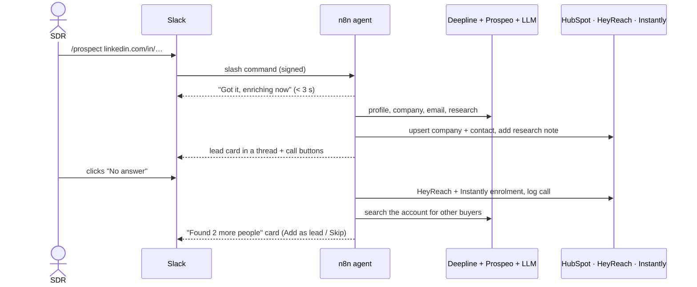

**The lead card** shows the person, title, company (size and industry), email with its verification status, phone,
LinkedIn reach, three research bullets and three cold-call openers, plus links to LinkedIn and the HubSpot record.

**The buttons**

| Button | What happens |
|---|---|
| **No answer** | Call logged in HubSpot → LinkedIn sequence (HeyReach) → email sequence (Instantly, only if the email is valid) → account expansion |
| **Picked up** | A modal asks for the call result, the goal of the follow-up and notes → the LLM drafts a LinkedIn message → the SDR can **Send**, **Edit**, **Regenerate** or **Copy** it |
| **Wrong person** | Logged and disqualified → the account is searched for the right buyer |
| **Add as lead / Skip** | On expansion suggestions: Add runs the full enrichment on that person; Skip hides them |
| **Retry** | On any error message: re-runs that lead's enrichment |

## 3. Live run, end to end

These screenshots come from one real run on a test profile: `/prospect`, then **No answer**. Personal names and
emails are blurred.

**① Lead card.** Deepline returned the profile and Prospeo a verified work email. The company came from its LinkedIn
page, and the LLM wrote the research and openers.


**② No answer.** The lead went into the LinkedIn and email sequences, and the status became `sequenced`. Expansion
searched the account in Prospeo, the LLM kept the 2 people who fit the buyer persona, and Datagma checked their emails.
Nobody new is contacted until the SDR clicks **Add as lead**.

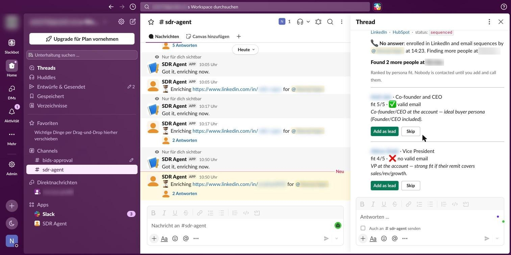

**③ The tools it drove**

| HeyReach: LinkedIn follow-up campaign | Instantly: lead in the live email campaign |
|---|---|
| 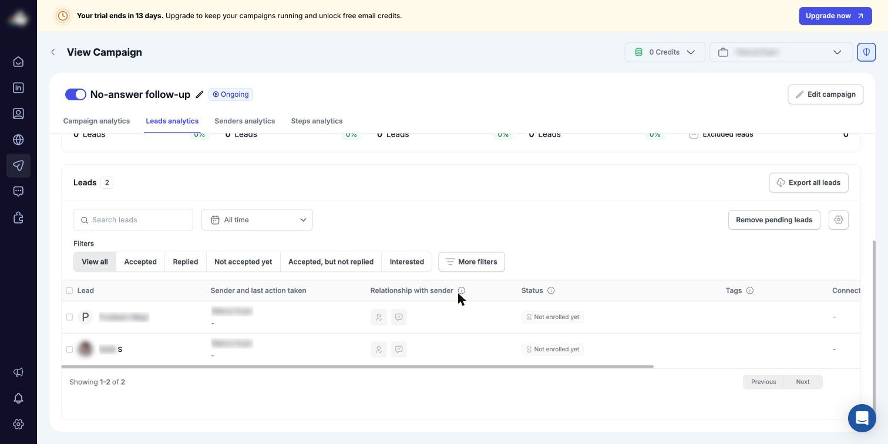 | 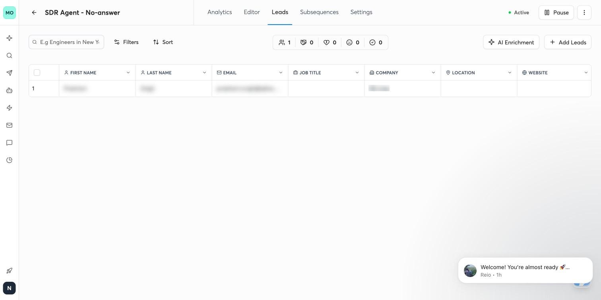 |
| **Instantly: the sequence** | **Instantly: step 1 actually sent** |
| 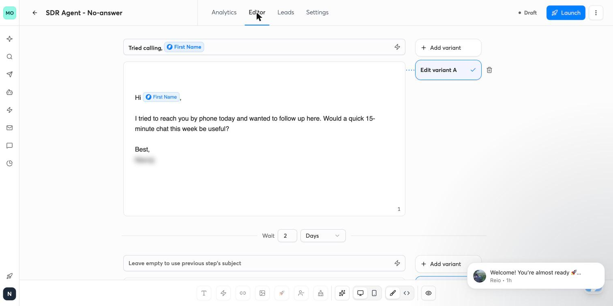 | 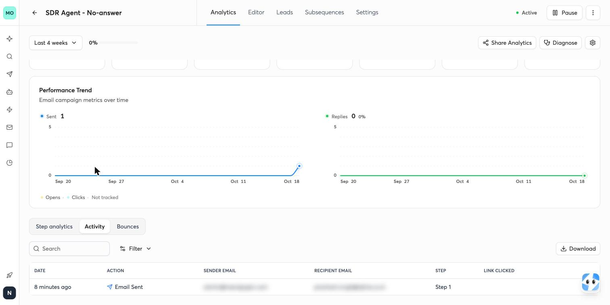 |

**④ HubSpot.** The contact was created with its owner and associated with the company. The research note and the
*No answer* call are on the timeline.

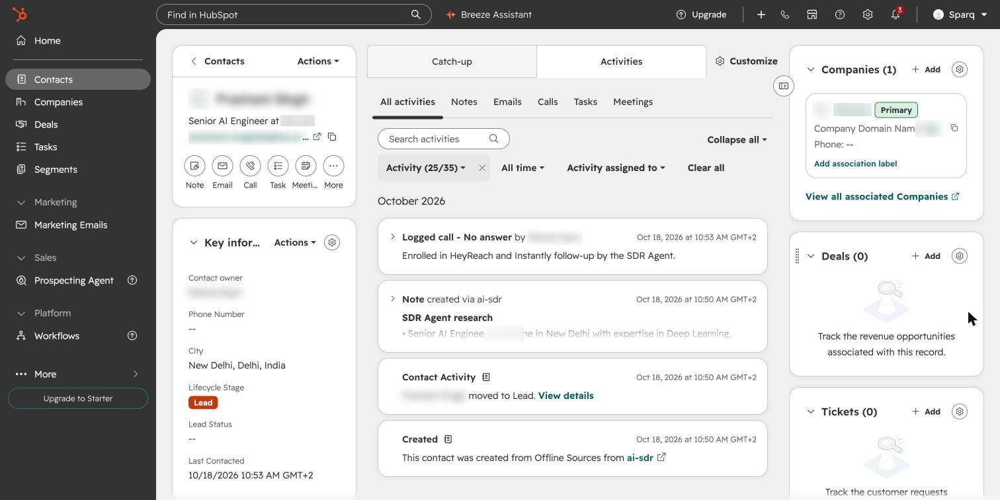

**⑤ Supabase, the source of truth.** It holds every lead's status, source, outreach events and call outcomes. The
two `account_expansion` rows are the suggested colleagues.

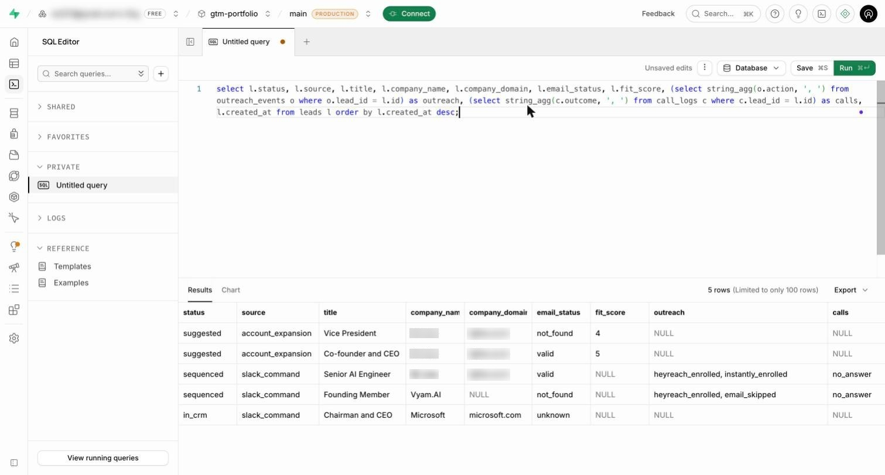

**⑥ The same run inside n8n.** Every node is green.

| Enrichment: 22 s | Account expansion: 17 s |
|---|---|
| 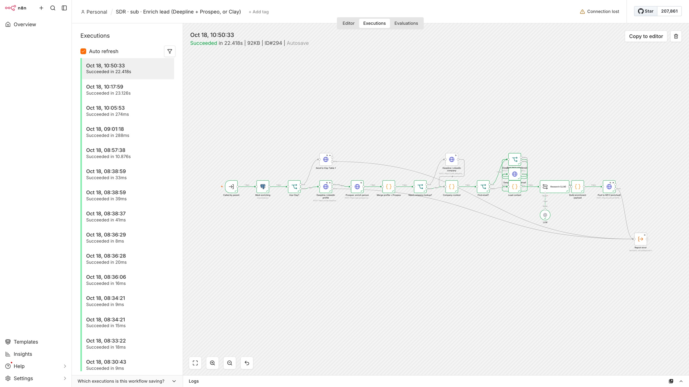 | 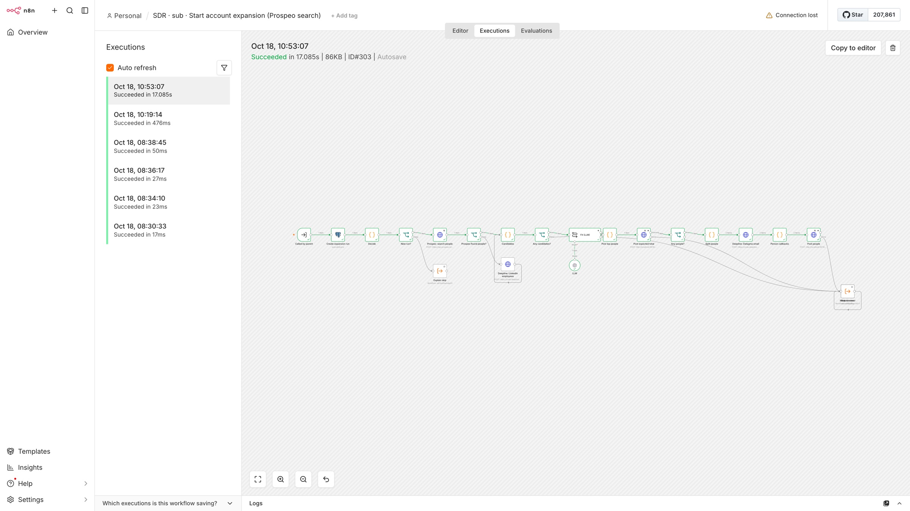 |

## 4. Architecture

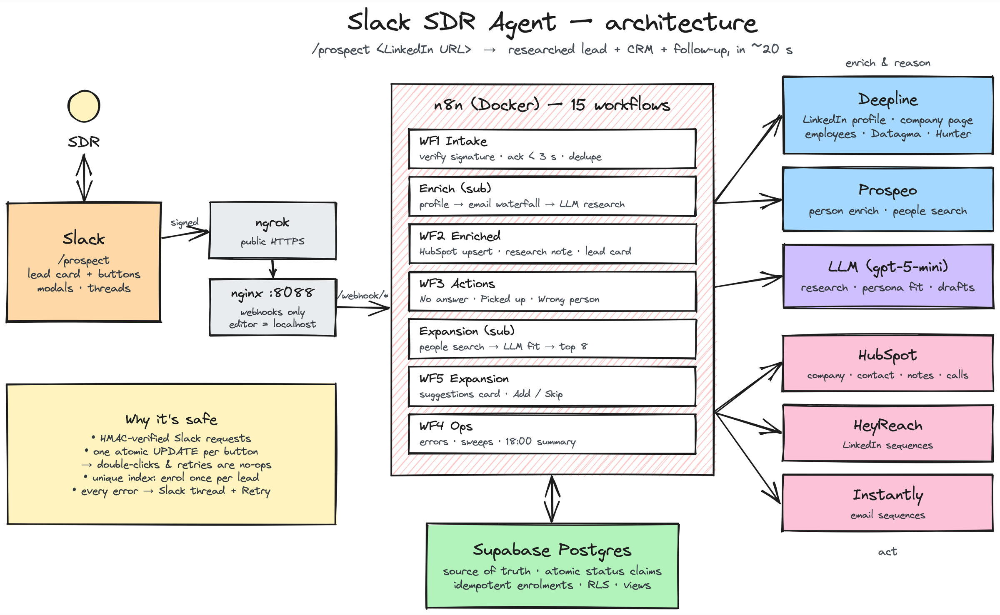

### Process map

The same flow as an operations process map in [Puzzle](https://puzzleapp.io). Each step shows its tool and who runs it
(person, automation or AI agent), with every branch labelled:

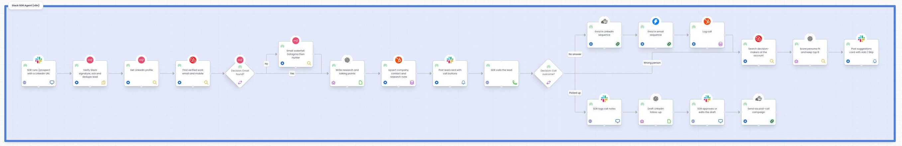

| Layer | Choice | Why |
|---|---|---|
| Interface | Slack slash command + Block Kit + modals | SDRs already live in Slack; no new tool to adopt |
| Orchestration | n8n 2.x, self-hosted in Docker | Visual and debuggable per execution, with code nodes where logic matters |
| Edge | nginx + ngrok | Public webhooks only. The n8n editor is blocked through the tunnel and reachable on localhost only |
| State | Supabase Postgres | Atomic status transitions, idempotency, reporting views, RLS |
| Enrichment | Deepline (HarvestAPI, Datagma, Hunter) + Prospeo | LinkedIn-accurate profiles plus verified contact data, paid per call |
| AI | OpenAI-compatible LLM (`gpt-5-mini`) | Research, persona scoring and message drafts |
| Systems of record | HubSpot, HeyReach, Instantly | CRM, LinkedIn automation, email sequencing |

## 5. How each part works

### WF1: Intake (`/prospect`)

1. **Verify** the Slack request signature (HMAC-SHA256 over the raw body, with a 5-minute replay window).
2. **Ack within Slack's 3-second limit** with an ephemeral "Got it, enriching now."
3. **Normalise** the URL. Query strings, `mwlite`, trailing slashes and case are stripped, so one person is one key.
4. **Dedupe insert** with `insert … on conflict (linkedin_url) do nothing`. If the lead exists, the SDR is told who owns it and gets a link to its thread.
5. **Open a thread** ("⏳ Enriching …") and start the enrichment sub-workflow.

### Enrichment (sub-workflow): replaces Clay Table 1

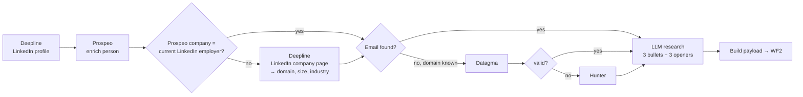

- **LinkedIn decides the current employer.** Databases often return a past job or a board seat. Prospeo's company is used only when its LinkedIn URL matches the person's current position. Otherwise the agent reads the employer's LinkedIn page and takes the domain from its website.
- **Email waterfall.** Prospeo first, because it comes with the person match. If that misses, Datagma, then Hunter, and only when a domain is known. The first *valid* result wins.
- **ICP flag.** A senior title (VP, Head, Director, C-level, Founder…) plus a company of 11–1,000 people.
- **Research prompt.** It may use only the data provided ("no guesses; if data is missing, say so") and returns strict JSON.
- **Same callback as Clay.** The result is posted to WF2's `/webhook/sdr-enriched` in the exact shape the Clay HTTP column used, so WF2 doesn't care which provider ran.

### WF2: Enriched → CRM → lead card

- Saves the enrichment, then upserts into HubSpot:
  - **Company:** searched by domain (name as a fallback), created if missing.
  - **Contact:** searched by email or LinkedIn URL. When it already exists, the agent updates the fields but **never changes an existing owner**, and posts a warning in the thread instead.
  - **Association and note:** contact ↔ company association, plus a "SDR Agent research" note.
- The owner comes from `sdr_owner_map` (Slack user → HubSpot owner).
- Posts the lead card in the thread and saves its timestamp, so later actions update the same card instead of posting new ones.

### WF3: Actions (every button and modal)

Each button first runs one **atomic claim**:

```sql
update leads set status = 'called_no_answer'
where id = $1 and status in ('in_crm', 'enriched')
returning *;
```

If no row comes back, someone already handled it, and the SDR gets an ephemeral "already handled" message. That one
pattern makes double-clicks, two SDRs clicking at once and Slack's automatic retries all harmless.

- **No answer**
  - Logs the call in HubSpot with the *No answer* disposition.
  - Adds the lead to the HeyReach no-answer campaign, with the best talking point as a custom field.
  - Adds the lead to Instantly, only if the email is valid.
  - Each enrolment is recorded behind a unique index, so it can only happen once per lead.
  - Updates the card and starts expansion.
- **Picked up**
  - Opens a modal (call result, follow-up goal, notes) and logs the call.
  - The LLM drafts a short LinkedIn message grounded in what was said, using the research only where it supports the call.
  - **Send** adds the lead to the HeyReach post-call campaign with the message as a custom field. **Copy** marks it as sent manually.
- **Wrong person:** disqualifies the lead and runs expansion to find the right contact.

### Account expansion (sub-workflow): replaces Clay Table 2

1. **Search.** A Prospeo `search-person` on the company domain, filtered to decision-maker seniorities (C-Suite, Founder/Owner, VP, Director, Head, Partner).
2. **Fallback.** When Prospeo has nobody (common for very small companies), Deepline's LinkedIn employee search runs. Results are checked against the company name, because LinkedIn matches companies by name.
3. **Clean up.** Drop the original lead, duplicates and persona exclusions (interns, recruiters, HR, assistants…).
4. **Score.** One LLM call scores every candidate 1–5 against `BUYER_PERSONA`, with a one-line reason. The top 8 with a score of 3 or more are kept.
5. **Email.** A Datagma lookup for each kept person.
6. **Hand over.** Post to WF5 in the same `expected_total` + `person` callback shape that Clay Table 2 used.

A company is searched at most once every 30 days, so the same account is never paid for twice.

### WF5: Expansion results

Each callback is stored as a `suggested` lead linked to the original (`parent_lead_id`). When `received_count`
reaches `expected_total`, one card is posted, ranked by fit and showing the email status, with **Add as lead / Skip**
per person. If the count is never reached, a sweep posts whatever has arrived after 10 minutes.

### WF4: Ops

| Trigger | What it does |
|---|---|
| Error trigger | Any unhandled failure in any workflow → `workflow_errors` row + Slack alert |
| Every 10 min | Leads stuck in `enriching` for 15+ min → marked `error`, with an alert and a **Retry** button. Stuck expansion runs → partial card posted |
| Daily 18:00 | Summary posted to the channel: new leads, calls, connected, sequenced, colleagues added/skipped, messages sent |
| Nightly 03:00 | Skipped suggestions older than 90 days are deleted (data minimisation) |

### Lead lifecycle

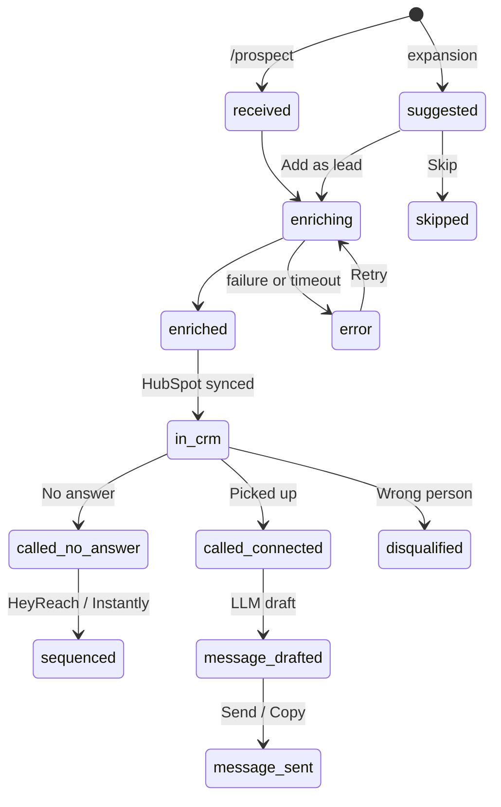

## 6. Data model

| Table | Purpose |
|---|---|
| `leads` | One row per person (unique `linkedin_url`): enrichment fields, HubSpot IDs, Slack thread and card timestamps, `status`, `source` (`slack_command` / `account_expansion`), `parent_lead_id`, `fit_score` |
| `expansion_runs` | One per account search: `expected_total`, `received_count`, card timestamp, status |
| `call_logs` | Every call outcome, with result, follow-up goal and notes |
| `outreach_events` | Every enrolment, draft and send. A unique partial index on `(lead_id, action)` makes enrolments happen once |
| `workflow_errors` | Every failure, with workflow, step and execution link |
| `sdr_owner_map` | Slack user → HubSpot owner |

**Reporting views:** `v_leads_per_sdr_per_day`, `v_connect_rate`, `v_daily_summary`. Row-level security is enabled on
every table, and the views run as `security_invoker`. Full schema: [`db/schema.sql`](db/schema.sql).

## 7. Reliability, safety and security

- **Idempotent everywhere.** Atomic status claims, a unique LinkedIn URL and once-only enrolment indexes. The design assumes every webhook can arrive twice.
- **Errors never disappear.** Every external call has an error branch to a shared *Report error* sub-workflow. It posts in the lead's thread with **Retry** and logs to `workflow_errors`. The Slack and error sub-workflows have no error workflow of their own, so an alert can't trigger itself in a loop.
- **"No match" isn't an error.** Prospeo and Deepline 4xx responses like `NO_MATCH` come back as data, so a missing email doesn't fail a run.
- **Retries.** External calls retry 3 times with backoff.
- **Security**
  - Slack signatures are verified on every request.
  - Enrichment callbacks require a shared secret header.
  - Only `/webhook/*` is exposed publicly; nginx returns 403 for the editor through the tunnel.
  - Secrets live in `.env` and in n8n's encrypted credentials, never in the repo.
  - The database has RLS on.
- **Human in the loop.** Expansion only *suggests* people, and LinkedIn messages are drafted for the SDR to approve. The agent never cold-messages someone the SDR didn't choose.
- **Privacy.** Skipped suggestions are deleted after 90 days, and screenshots in this repo are blurred.

## 8. Engineering decisions and trade-offs

| Decision | Why | Trade-off |
|---|---|---|
| **Workflows as code.** Python generates the n8n JSON and the Code nodes are real `.js` files | Reviewable diffs, reusable helpers (e.g. one `guard()` gives every risky node an error path), and fixed IDs so deploys are repeatable | You edit the Python, not the canvas. The canvas is the debugger, not the source |
| **Supabase as source of truth**, HubSpot as a mirror | Atomic transitions and idempotency need a real database. The CRM can't be the lock | Two stores to keep in sync. WF2 is the only writer to HubSpot, which keeps that simple |
| **Replace Clay with direct APIs** | Every step is versioned, testable and visible in one execution log. You pay per call, and only when the earlier step missed | More to own: provider quirks are handled in code (e.g. the LinkedIn employer check) |
| **Same callback contract as Clay** | WF2 and WF5 didn't change when the provider changed, and Clay still works behind one env var | The payload shape is a little Clay-flavoured |
| **LinkedIn decides the current employer** | Data providers often attach a past or side company, and a wrong company poisons the CRM and the expansion | One extra cheap call ($0.003) when the providers disagree |
| **Ack first, work async** | Slack drops slash commands that take more than 3 s | Results arrive as a follow-up message, not inline |
| **LLM only where judgement is needed** (research, fit, drafts) | Deterministic code for everything else is cheaper, faster and testable | Prompts are kept strict, and the outputs are parsed defensively |

## 9. Testing

[`scripts/e2e_mock_test.py`](scripts/e2e_mock_test.py) drives the **real** n8n workflows with a **real** LLM and a
local Postgres. Slack, HubSpot, HeyReach, Instantly, Deepline and Prospeo are replaced by
[`scripts/mock_apis.py`](scripts/mock_apis.py), which logs every request so the test can assert on the payloads.

The 33 checks cover:

- signature-verified intake and dedupe
- enrichment calls and saved fields
- HubSpot upsert and the lead card
- No answer, including double-click safety
- Prospeo expansion: the original lead and the intern are excluded, and emails come from Datagma
- Add and Skip, each updating the expansion card
- Picked up: modal → AI draft → regenerate → edit → send to HeyReach with the edited text
- zero rows in `workflow_errors`

```
PASS WF3 double click ignored
PASS WF5 two suggestions (original + intern excluded)
PASS WF3 AI draft created
     draft: Good talking, Max. You said you hate manual CRM updates — I've got the case study I promised…
PASS WF3 HeyReach post-call with edited text
PASS No workflow errors

0 failure(s)
```

## 10. Cost

Observed on the live run. Deepline bills about $0.10 per credit, and Prospeo bills in its own credits.

| Step | Provider | Cost | Runs when |
|---|---|---|---|
| LinkedIn profile | Deepline (HarvestAPI) | 0.05 cr ≈ $0.005 | Every lead |
| Person + email | Prospeo | 1 credit (mobile reveal costs more) | Every lead |
| Company page | Deepline (HarvestAPI) | 0.03 cr ≈ $0.003 | Only if Prospeo's company isn't the current employer |
| Email fallback | Datagma / Hunter via Deepline | 0.14 / 0.30 cr | Only if Prospeo has no email |
| Research | LLM | < $0.01 | Every lead |
| Account search | Prospeo | 1 credit per page of 25 | Once per company per 30 days |
| Suggested people's emails | Datagma | 0.14 cr each (max 8) | Per expansion |

## 11. Run it yourself

The short version is below. [`docs/SETUP.md`](docs/SETUP.md) has the step-by-step setup for every service (Slack app,
Supabase, HubSpot, HeyReach, Instantly, Deepline, Prospeo, ngrok).

```bash
cp .env.example .env              # fill in the keys
docker compose up -d              # n8n + nginx (+ local Postgres for tests)
psql "$SUPABASE_DB_URL" -f db/schema.sql
python3 scripts/hubspot_setup.py  # custom HubSpot properties + owner IDs
ngrok http 8088                   # put the URL in WEBHOOK_URL and the Slack manifest
./scripts/deploy.sh               # build, import and publish all 15 workflows
```

Then type `/prospect https://www.linkedin.com/in/<someone>` in your Slack channel.

## 12. Repository layout

```
├── scripts/
│   ├── build.py            # generate workflows/*.json + n8n credentials from .env
│   ├── lib.py              # node helpers: webhook, sql, http, if, slack, sub-workflow calls
│   ├── main_flows.py       # WF1 intake, WF2 enriched, WF5 expansion results
│   ├── actions.py          # WF3: every button and modal
│   ├── subs.py             # enrichment, HubSpot sync, lead card, drafts, error reporting
│   ├── expansion.py        # account expansion (Prospeo search → LLM fit → Datagma)
│   ├── ops.py              # WF4: errors, sweeps, daily summary, cleanup
│   ├── deploy.sh           # build → import → publish → restart
│   ├── e2e_mock_test.py    # 33-check end-to-end suite
│   ├── mock_apis.py        # mocks for every external API
│   └── slack_sim.py · executions.py · hubspot_setup.py
├── workflows/
│   ├── src/*.js            # Code-node JavaScript (signature check, merge, waterfall, cards, modals…)
│   └── *.json              # generated n8n workflows (don't hand-edit)
├── db/schema.sql           # tables, indexes, trigger, views, RLS
├── slack/manifest.json     # Slack app manifest
├── nginx/nginx.conf        # webhooks public, editor local-only
├── clay/CLAY_SETUP.md      # the original Clay design (still supported)
├── docs/SETUP.md           # step-by-step setup
└── docker-compose.yml
```

## 13. What I'd build next

- **Replies close the loop.** HeyReach and Instantly reply webhooks would update the lead and post "replied" in the thread.
- **Calls logged automatically.** A dialer integration (Aircall or Nooks) to record outcomes without a button press.
- **Persona tuning.** Track which suggested titles SDRs actually add, and feed that back into the fit prompt.
- **Static tunnel.** An ngrok static domain or Cloudflare Tunnel, so the Slack URLs never change.
- **Weekly SDR dashboard.** Built from the existing views: connect rate, sequence replies, cost per meeting.

---

Built by **Neeraj Sujan**.
